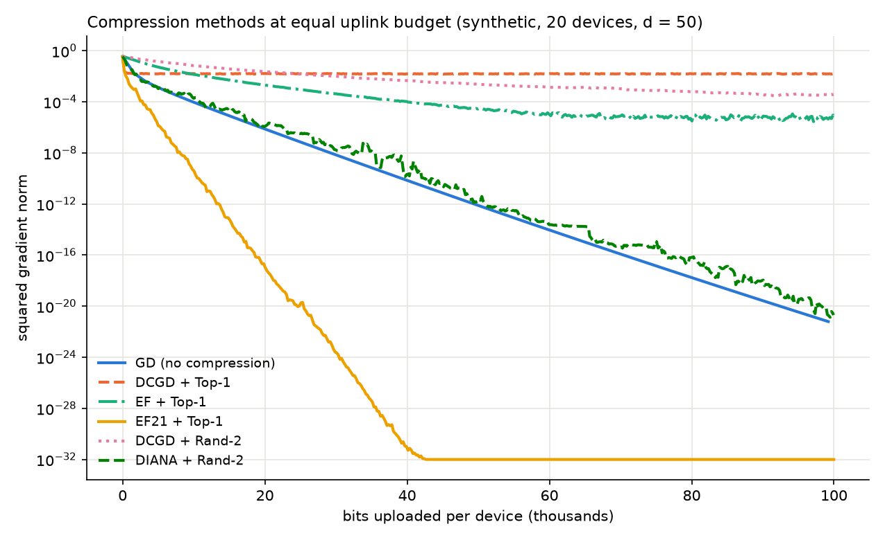
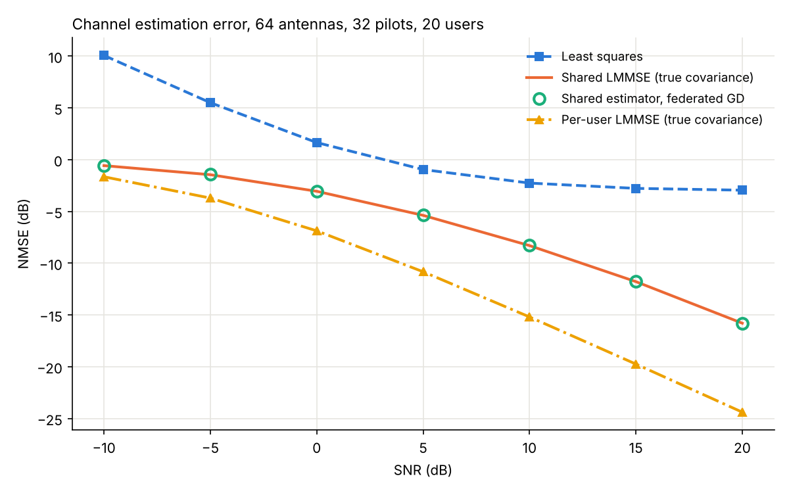

# fl-compression-bench

A small, tested simulator for comparing gradient compression methods in
federated learning, with federated channel estimation as the target task.

The question: for a federated channel estimator, which compression method
reaches a given estimation accuracy with the fewest uploaded bits, and do the
methods behave as their theory predicts?

This is a benchmark study. It does not propose a new method.

## Status

| Step | Content | State |
| --- | --- | --- |
| 1 | Reading: update rules and theoretical stepsizes of each method | in progress |
| 2 | Core simulator: devices, server, full local gradients, bit counter | done |
| 3 | Compressors: Rand-k, Top-k, with bit costs | done |
| 4 | Methods: compressed GD (DCGD), DIANA, classic error feedback, EF21 | done |
| 5 | Channel estimation task with least squares and LMMSE baselines | done |
| 6 | Experiments | to do |
| 7 | Report | to do |

## Layout

```
fedcomp/
  problems.py   LeastSquares, LogisticRegression and LinearEstimation as sums over devices
  channel.py    channel model, pilots, least squares and LMMSE estimators, error measures
  methods.py    GD, DCGD, DIANA, EF and EF21, each split into device_step / server_step
  simulator.py  the training loop and the History record
  bits.py       bit accounting for uplink messages
  compressors.py  Identity, Rand-k (scaled and unscaled), Top-k
  data.py       synthetic data, LibSVM loader, IID and by-label splits
tests/
  test_core.py         tests for step 2
  test_compressors.py  tests for step 3
  test_methods.py      tests for step 4
  test_channel.py      tests for step 5
scripts/
  run_baseline.py      demo run of uncompressed federated GD
  show_compressors.py  each compressor applied to one example vector
  compare_methods.py   all methods at an equal bit budget, with a plot
  channel_baselines.py estimation error against SNR for the baselines, with a plot
```

## Setup

```
python -m venv .venv
.venv\Scripts\activate        (Windows)   or   source .venv/bin/activate
pip install -r requirements.txt
pytest -q
python scripts/run_baseline.py
```

## Design

One round of training:

1. the server broadcasts the model `x`
2. each device computes its local gradient at `x`
3. each device runs `method.device_step` and uploads a `Message` (payload and bit cost)
4. the server runs `method.server_step` and updates `x`

A method is split into `device_step` and `server_step` so that the code
mirrors where computation happens: device code sees only its own gradient
and state, server code sees only messages. Both receive the stepsize and the
server returns the step to add to `x`, which lets the same interface cover
plain gradient descent, DIANA, classic error feedback and EF21.

Device `i` holds `m_i` points and has weight `p_i = m_i / sum_j m_j`. The
objective is `F(x) = sum_i p_i F_i(x)`. Only uplink bits are counted, with a
real number costing 32 bits.

## What the step 2 tests check

- the hand-computed round from the study notes: five devices, two parameters,
  one step from (0, 0) to (0.71, 0.38), loss 9.3 to 3.97
- gradients against finite differences
- federated GD equals GD on the pooled data to 1e-10, with equal and unequal
  device sizes
- GD with stepsize 1/L decreases the loss in every round
- GD reaches the exact least squares solution
- the smoothness bound holds on random pairs of points
- the bit counter: `rounds * 32 * d` per device for uncompressed GD

## What the step 3 tests check

- Rand-k is exactly unbiased and its variance is exactly `(d/k - 1) ||x||^2`,
  verified by listing every possible mask on a five-entry vector
- the random sampler agrees with that theory over 40,000 draws and picks
  every coordinate equally often
- the same seed reproduces the same mask, which is what lets the server
  rebuild it without receiving positions
- Top-k keeps the largest magnitudes and satisfies
  `||C(x) - x||^2 <= (1 - k/d) ||x||^2`, with equality for equal magnitudes
- bit costs: Rand-k is `32k + 32` (values plus a seed), Top-k is
  `k (32 + ceil(log2 d))` (values plus positions)

## What the step 4 tests check

- with no compression (identity, or k = d) every method reproduces plain
  gradient descent
- DCGD with Top-1 diverges on the three-quadratics example of Beznosikov et
  al., and one step matches the hand calculation `x <- (1 + 11 gamma / 6) x`
- DCGD with Rand-k stalls at a floor proportional to the stepsize
- DIANA converges to the exact least squares solution where DCGD stalls, and
  its shifts `h_i` converge to the local gradients at the solution
- classic error feedback: the virtual iterate `x - sum_i p_i e_i` follows
  exact gradient descent
- EF21: the server's estimate equals the weighted device estimates in every
  round, the method converges where DCGD diverges, and the measured average
  squared gradient norm is below the bound of the paper's theorem at the
  theorem's stepsize
- bit counts per round, reproducibility from the seed, independent masks
  across devices

## First comparison

`python scripts/compare_methods.py` runs all methods on logistic regression
with a nonconvex regularizer, 20 devices with very different data, at
100,000 uploaded bits per device, with the same stepsize search for each
method. On the synthetic data:

| Method | Bits per round | Final squared gradient norm |
| --- | --- | --- |
| GD (no compression) | 1600 | 6.2e-22 |
| DCGD + Top-1 | 38 | 1.4e-02 |
| EF + Top-1 | 38 | 5.7e-06 |
| EF21 + Top-1 | 38 | 4.3e-33 |
| DCGD + Rand-2 | 96 | 3.7e-04 |
| DIANA + Rand-2 | 96 | 2.0e-21 |



This is synthetic data with 50 parameters. It checks that the methods show
the qualitative behaviour reported in the papers. It is not yet a result.

## The channel estimation task

A base station with 64 antennas sends 32 pilot symbols. A single-antenna
user receives `y = P h + noise` and must estimate its channel `h` (64 complex
numbers) from `y` (32 complex numbers). Channels are sums of 3 paths whose
angles lie in the user's own 10 degree sector, and the 20 users' sector
centres are spread over 30 degrees, so every user's data is different.

The model trained federatedly is one matrix `W` shared by all users, with
`h_hat = W y`. In real numbers it has 128 x 64 = 8192 parameters. This model
is convex and its best possible value is known: it is the LMMSE estimator for
the users' average covariance. That gives every training run an exact target.

`python scripts/channel_baselines.py` gives (NMSE in dB):

| SNR (dB) | Least squares | Shared LMMSE | Per-user LMMSE | Shared, federated GD |
| --- | --- | --- | --- | --- |
| -10 | 10.07 | -0.57 | -1.65 | -0.55 |
| 0 | 1.66 | -3.05 | -6.87 | -3.03 |
| 10 | -2.26 | -8.30 | -15.19 | -8.28 |
| 20 | -2.94 | -15.79 | -24.39 | -15.80 |



Least squares cannot recover 64 unknowns from 32 pilots. The federated
estimator, trained on samples only, matches the shared LMMSE estimator built
from the true covariance. The gap to per-user LMMSE is the price of one model
for all users.

Limits of the setup: the true channel is used as the training label, which a
real handset does not have; the uplink is error-free; the downlink is not
counted.

## What the step 5 tests check

- steering vectors and pilot rows have unit norm, channel power is N, noise
  power is as configured
- the exact covariance (numerical integration) matches the sample covariance
- the closed-form error of a linear estimator matches simulation, for least
  squares and LMMSE at several SNRs
- LMMSE is the best linear estimator: every perturbation increases the error
- ordering at every SNR: least squares, then shared LMMSE, then per-user LMMSE
- the real-valued matrix acts exactly like the complex one
- gradient of the estimation problem against finite differences; federated
  training equals pooled training; GD reaches the exact solution
- the trained estimator is within 0.15 dB of the shared LMMSE
- EF21 with Top-k trains the estimator to within 2% of the best error

## References

- Konečný, McMahan, Yu, Richtárik, Suresh, Bacon. Federated Learning: Strategies for Improving Communication Efficiency. arXiv:1610.05492
- Mishchenko, Gorbunov, Takáč, Richtárik. Distributed Learning with Compressed Gradient Differences (DIANA). arXiv:1901.09269
- Beznosikov, Horváth, Richtárik, Safaryan. On Biased Compression for Distributed Learning. arXiv:2002.12410
- Richtárik, Sokolov, Fatkhullin. EF21: A New, Simpler, Theoretically Better, and Practically Faster Error Feedback. arXiv:2106.05203
